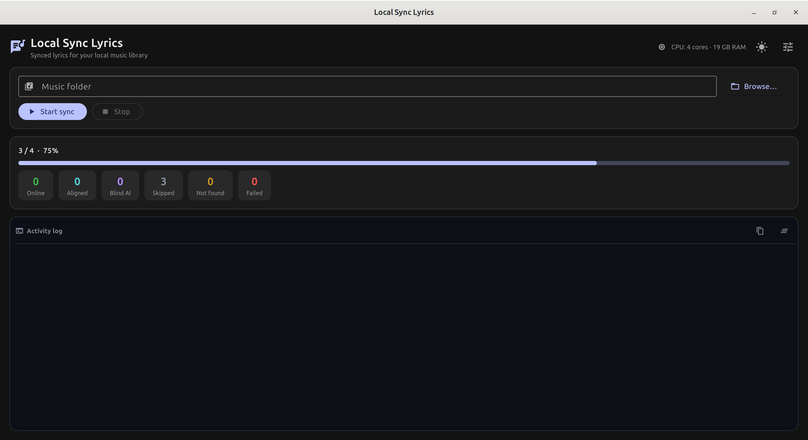

# Lyricist - the song lyrics generator 🎼🎵🎶

Desktop app (Windows + Linux) that writes **synced `.lrc` lyrics** next to your music.
It searches first, listens second and guesses last:
## 🖥️ App Preview

<p align="center">
  
</p>

## How it works

```
Tier 1  synced providers   LRCLIB → BetterLyrics → RCLyricsBand → Megalobiz → NetEase → QQ Music   → save .lrc
Mashup  "A x B", "A / B", "A & B (Mashup)", "A vs B"  → split into songs, fetch each one's lyrics
Tier 2  plain-text lyrics  Genius → Lyrics.ovh → Musixmatch (key)                                   → official WORDS
Listen  nothing found / a song unnamed → blind-listen to slices, search lyric DBs, VERIFY the match
Align   official words + Whisper word timestamps → forced alignment → .lrc with the OFFICIAL spelling
Blind   only if no text exists anywhere (or the alignment is too weak to trust) → plain Whisper
```

## How to use

```
python -m venv .venv && source .venv/bin/activate      # Windows: .venv\Scripts\activate
pip install -r requirements.txt
python main.py                                          # GUI
python main.py --cli ~/Music --no-ai                    # headless (rich progress)
```

Python 3.10–3.13 recommended. No new dependencies were added by the alignment upgrade.

## How the upgraded pipeline works

**1. Provider chain (`api_providers.py`).** Nine isolated providers in two tiers. Every hit is a
`LyricsResult` whose `kind` is `SYNCED` (save it) or `PLAIN_TEXT` (align it). Candidates are fuzzy-scored
on artist/title/duration and validated (does the LRC fit the track? does the text look like lyrics?).
A provider that is offline, rate-limited or has changed its layout is logged and skipped.

**2. Mashup detection (`text_utils.detect_mashup`, `processor.py`).** The title (then the file name) is split
on `x`, `×`, `vs`, `/`, `+`, `→`, and on `&`/`and` only when a mashup keyword is present
(`mashup`, `bootleg`, `megamix`, `medley`…), so `Simon & Garfunkel` stays whole. Each match carries a
confidence: ≥75 % goes straight to the component pipeline after the full-title Tier 1 search; 50–75 %
(`Day / Night`) first tries the full title as a normal song. Components that cannot be resolved by name are
found by listening: Whisper transcribes ~30 s slices at 2 %, 30 %, 55 % and 80 % of the track, the most
distinctive words go to Genius / Musixmatch lyric search, and **a candidate is accepted only if the sung
words really appear in its lyrics** (fuzzy `partial_ratio` ≥ 70).

**3. Forced alignment (`lrc_utils.ForcedAligner`, `transcriber.AudioSession.align`).**
* Audio is processed in 30 s windows (3 s overlap). One window per call is deliberate:
  faster-whisper applies `initial_prompt` only to the first window of a call, and keeps only ~223 prompt
  tokens. Each call therefore gets the *lines expected next* (tracked position per song), trimmed to a token
  budget, plus `word_timestamps=True` and a singing-tuned `vad_filter=True`.
* Recognised words are matched to the official lines with `difflib.SequenceMatcher` after snapping misheard
  words to the song's own vocabulary (`thefuzz`). Matching *tracks* position per song, so repeated choruses,
  sections that were cut from the audio, and interleaved songs of a mashup all resolve; each change of song is a
  located transition.
* Output lines are the official text with the time of their first word. Unheard words are placed at the
  singer's tempo; stretches whose timing is still a guess are re-listened to (no VAD, missing lines as the
  prompt). If VAD swallows soft vocals the whole pass is repeated without it.
* Quality gate: the lyrics must explain ≥ 40 % of the sung words (`min_alignment_match`), otherwise the result
  is not trusted. Wrong lyrics (a different song, a different version) are rejected rather than written.

**4. Preserved safeguards.** PyAV-version-proof decoding (`metadata_errors` TypeError handled; works with
`av==12.3.0` *and* current releases), CUDA→CPU int8 fallback during inference, SQLite cache, atomic writes,
per-file error isolation, thread-safe event queue to the GUI, and: if the Whisper model cannot be loaded
(offline first run) every AI step is skipped once for the whole batch and the tracks are retried next run.

GUI log tags: `[API: Tier 1]`, `[API: Plain Text]`, `[Mashup Detected]`, `[AI: Identify]`,
`[AI: Forced Alignment]`, `[AI: Blind]`.

## Providers

| Tier | Provider | Needs | Notes |
|---|---|---|---|
| 1 | LRCLIB | – | JSON API, exact + fuzzy search |
| 1 | BetterLyrics | – | TTML → LRC |
| 1 | RCLyricsBand | – | form search + HTML scrape |
| 1 | Megalobiz | – | HTML scrape |
| 1 | NetEase | – | public web API; credit lines (`作词 :`) stripped |
| 1 | QQ Music | – | public web API; base64/JSONP handled |
| 2 | Genius | optional token | official search API with a token, public search without; page scrape for text |
| 2 | Lyrics.ovh | – | direct lookup + Deezer-backed suggestions |
| 2 | Musixmatch | API key | free plan returns excerpts → flagged partial; also identifies songs by lyric snippet |

## Settings & environment variables

Stored in `%APPDATA%\LocalSyncLyrics\settings.json` / `~/.config/LocalSyncLyrics/settings.json`
(cache, models, logs in the data folder; `LSL_HOME` makes everything portable). Older settings files are
upgraded automatically (new providers are enabled).

| Variable | Used when settings.json has no value |
|---|---|
| `HF_TOKEN` / `HUGGING_FACE_HUB_TOKEN` | Hugging Face token |
| `GENIUS_ACCESS_TOKEN` / `GENIUS_TOKEN` | Genius API token |
| `MUSIXMATCH_API_KEY` | Musixmatch key |
| `LSL_WHISPER_MODEL`, `LSL_LANGUAGE` | model / language |

Tokens are never copied from the environment into the file and are never logged. New switches:
*Forced alignment*, *Detect mashups*, *Name unknown songs by listening*.

## Packaging

```
pip install -r requirements-dev.txt
python build.py            # runs `flet pack` -> ./dist
```

## Verification status — please read

Verified offline in a Linux sandbox (Flet 1.1.2, faster-whisper 1.2.1, PyAV 19): **95 tests**, a 60-seed noise
sweep of the aligner, and an end-to-end offline run of the real pipeline (log tags, graceful degradation).

Aligner accuracy on **simulated** recognition errors (12 % misheard, 6 % dropped, 3 % hallucinated words),
share of lines timestamped within 0.7 s of the truth, 80 random seeds:
plain song 99.6 % · chorus repeated but written once 98.6 % · interleaved two-song mashup 98.7 % ·
section cut from the audio 99.8 % · fully unheard line 99.8 % · wrong lyrics wrongly accepted 0 / 80.
At 25 % misheard / 12 % dropped: 98 % / 93 % / 93.5 % / 99.8 % / 99.7 %.

**Not verified** (no network, display, GPU or model weights in the sandbox): live responses of every provider
(NetEase, QQ Music, RCLyricsBand, Megalobiz and Genius are unofficial endpoints/scrapes and can change), real
Whisper word-timestamp quality on singing, real mashup recordings, and the rendered window. The simulated
numbers measure the *aligner*, not Whisper: real accuracy depends on how well Whisper hears the vocals
(heavy effects, rap and layered mashups are harder). The ≥ 40 % quality gate exists so that a poor result
falls back instead of being written.
